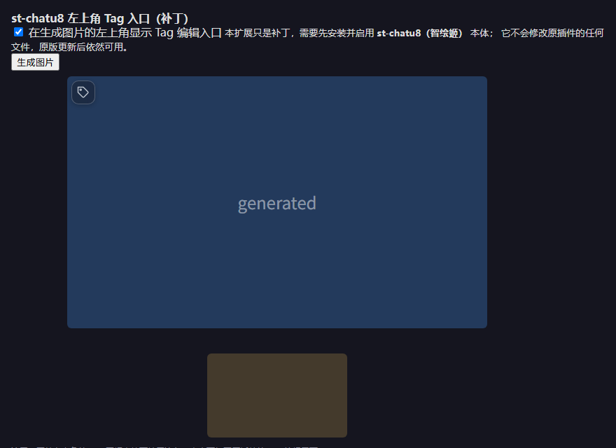

# st8-zhihuiji · st-chatu8 左上角 Tag 编辑入口（补丁扩展）

给 [st-chatu8（智绘姬）](https://github.com/damoshen123/st-chatu8) 生成好的图片**左上角**加一个 Tag 图标，
点一下就能打开原插件的 Tag 编辑界面（改提示词、看图、重新生成、tag 操作菜单……）。

这是一个**独立扩展**：装原版插件 + 装这个补丁就生效，**不修改原插件的任何文件**，所以原插件更新后补丁依然可用。



## 安装

两种方式任选：

**方式一：酒馆内安装（推荐）**

1. 先安装并启用原插件 `st-chatu8`（智绘姬）。
2. 打开酒馆 → 顶栏「扩展」(Extensions) → `Install Extension`（安装扩展）。
3. 填入本仓库地址：
   ```
   https://github.com/yiketaiyang123/st8-zhihuiji
   ```
4. 重启酒馆或刷新页面。

**方式二：手动安装**

把整个文件夹放到：

```
SillyTavern/public/scripts/extensions/third-party/st8-zhihuiji
```

刷新页面即可。

## 使用

图片生成完成后，图片左上角会出现一个小标签图标：

- **点它** → 打开 Tag 编辑界面。
- 图标默认半透明，鼠标移上去变清晰并变成蓝色；手机上是常驻显示。
- 点图片其它位置的行为不变（单击预览、双击重生成、长按编辑都照旧）。
- 只对图片生效，视频不加图标。

## 设置

酒馆「扩展」面板里会多出一项 **st-chatu8 左上角 Tag 入口（补丁）**，可在其中开关：

- 关掉后，已显示的图标会立即移除；
- 重新打开后，对之后渲染/生成的图片生效。

## 工作原理

原插件在每张生成图片上绑定了「长按 1200ms 打开编辑框」的监听，触发时会检查设置项 `longPressToEdit`。
本补丁点击图标时：

1. 临时把 `extension_settings["st-chatu8"].longPressToEdit` 设为 `"true"`；
2. 向该图片派发一次合成的 `mousedown`（`bubbles: false`，不会触发预览/双击），并保持按住状态；
3. 原插件自己的长按定时器到点后调用它自己的 `showEditDialog()`；
4. 编辑界面（`.st-chatu8-edit-backdrop`）出现的瞬间，抬起长按并把 `longPressToEdit` 原样还原。

因为不预设原版的长按阈值（等编辑框出现才抬起），即使作者以后调整了长按时长也仍然有效；
5 秒内没等到编辑框则放弃并还原设置，同时在控制台给出提示。

因此：不会写坏用户设置、不需要 hook 原插件的内部函数、也不依赖它的打包产物被修改。

为了让图标真正贴着图片的左上角（原插件的图片容器是整行宽、图片居中），定位按 `img` 与容器的
`getBoundingClientRect()` 差值计算，并用 `ResizeObserver` 跟随尺寸变化，所以左/中/右对齐、
25%–100% 显示大小、折叠展开、iframe 消息都能贴准。

## 兼容性

- 依赖原插件的这几个公开特征：`.st-chatu8-image-container`、图片是容器的直接子节点、
  `.st-chatu8-image-span[data-request-id]` 与 `.st-chatu8-image-button[data-request-id]` 配对、
  长按 1200ms 打开 `.st-chatu8-edit-backdrop`、设置项 `longPressToEdit`。
- 原插件将来若自带该功能（容器里出现 `.st-chatu8-image-edit-corner`），本补丁会自动让位，不会出现两个图标。
- 如果某次原插件更新后点击图标没反应，按 F12 看 Console 是否有
  `[st8c] 没能打开 Tag 编辑界面：原插件版本可能已变更` —— 说明原插件的长按逻辑或类名改了，需要适配，
  欢迎提 issue 附上版本号与报错。

## 卸载

删除 `third-party/st8-zhihuiji` 文件夹并刷新页面即可，原插件不受影响。

## 许可

MIT，随便用、随便改。
